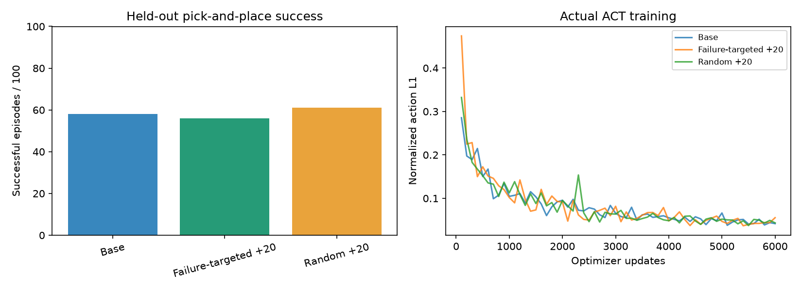
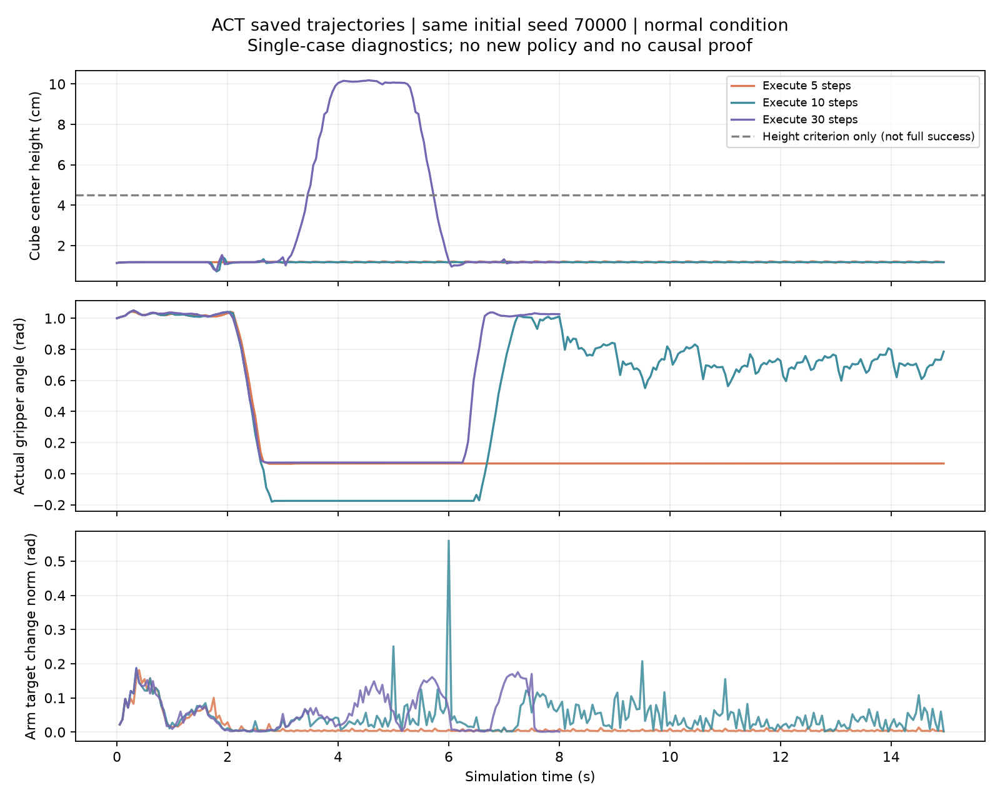

# SO101 ACT 视觉抓取与泛化实验

基于 MuJoCo、开源 SO101 模型与 LeRobot ACT 的仿真项目。双相机 RGB 与六维关节状态输入策略，执行抓取、搬运和放置。

本仓库整理本地任务封装、数据采集、训练适配、评测代码和已记录实验。实现由 Codex 协助完成；ACT 算法及上游资产归原作者所有。没有真实机械臂部署。

## 演示与结果

[模型自主成功视频](results/random/test-standard-dense/success.mp4) · [同模型失败视频](results/random/test-standard-dense/failure.mp4)

| 实验 | 对照 | 实验组 | 评测范围 |
|---|---:|---:|---|
| 亮度增强，普通光照 | 65/100 | 76/100 | 同轮配对初始条件 |
| 亮度增强，变暗光照 | 64/100 | 68/100 | 同轮配对初始条件 |
| 桌色增强，新桌色 | 33/100 | 45/100 | 四种桌色，各25回合 |

仅一个训练种子；各轮初始条件不同，不跨轮比较成功率。动作窗口实验也保留了负结果。报告：[基础](results/实验报告.md)、[亮度](results/brightness/实验报告.md)、[背景](results/background/实验报告.md)、[动作窗口](results/closed_loop/实验报告.md)。

## 复现与代码入口

这是本地实验的源码与结果快照。权重、完整示范和上游源码未上传；克隆后不能直接评测已有权重，需要恢复依赖并重新采集、训练。

1. 在 Windows + WSL Ubuntu 24.04 或 Linux 中准备 Python 3.12、uv、PyTorch 及 OpenGL/OSMesa。
2. 在 Windows PowerShell 执行 `scripts/bootstrap_sources.ps1`，按 `sources.json` 恢复固定版本上游源码和 SO101 资产。
3. 阅读 [本机运行说明](LOCAL_EXPERIMENT.md)。其中 `setup.sh` 与 `common.sh` 包含本机 uv、渲染和环境路径，应先按目标机器调整；不是通用一键安装器。
4. 安装依赖后执行采集、训练及评测入口；每一轮完整协议见 `docs/*protocol.md`。旧协议锁定原源码/权重指纹，不能通过改写记录将新运行冒充历史实验。

主要实现：`scripts/so101_env.py`、`expert.py`、`collect.py`、`train_act.py`、`evaluate_act.py`；实验与审计位于同目录，契约测试位于 `tests/`。

上游许可证及贡献说明：[THIRD_PARTY.md](THIRD_PARTY.md)。

## 动作窗口失败分析

新增[保存轨迹诊断](results/closed_loop/diagnosis-20261021/分析报告.md)与[面试讲述](docs/diagnosis-interview-20261021.md)：配对统计改善和退步，并对同一初始条件检查方块高度、夹爪状态及动作目标变化。只分析已有结果，没有新增训练或恢复控制器。

