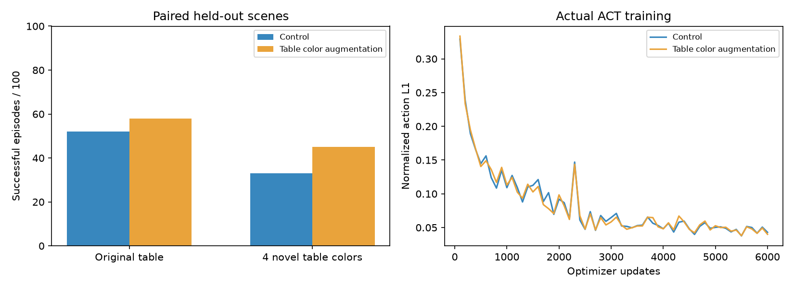

# 背景泛化：换一张桌子，还会抓方块吗？

本机已实际训练、加载保存权重并完成自主评测。新背景变化 +12 个百分点，原背景变化 +6 个百分点。只报告本次单一训练种子的观察。

## 同题对照成绩

| 版本 | 部署快照步数 | 原桌面 | 训练没见过的四种桌色（合计） |
| --- | --- | --- | --- |
| 普通对照 | 6000 | 52/100 | 33/100 |
| 桌色增强 | 6000 | 58/100 | 45/100 |

最终场景固定为种子60000—60099，两模型、两条件使用同一批100个初始条件，合计400回合。新背景按种子分成四组，每种25回合，不是每种100回合。不能把本表与旧测试集61或76分直接相减来认定进步。

## 每种新桌色

| MuJoCo桌面RGB因子 | 对照 | 背景增强 |
| --- | --- | --- |
| (0.25, 0.35, 0.4) | 6/25 | 9/25 |
| (0.4, 0.25, 0.65) | 6/25 | 8/25 |
| (0.35, 0.6, 0.3) | 5/25 | 12/25 |
| (0.7, 0.45, 0.2) | 16/25 | 16/25 |

## 为什么要做这一步

先在单独开发场景22000—22019上换成固定深色桌面：旧对照模型成功2/20，旧亮度增强模型成功1/20。它们提示了背景弱点；本轮正式结论使用重新训练的同预算对照。

## 新模型开发诊断

| 版本 | 原桌面 | 固定深色桌面 |
| --- | --- | --- |
| 普通对照 | 11/20 | 3/20 |
| 桌色增强 | 9/20 | 6/20 |

配方预先固定为8种训练桌色，没有根据最终成绩重选范围或训练次数。

## 同场景的进退

| 条件 | 两版都成功 | 原失败新成功 | 原成功新失败 | 两版都失败 |
| --- | --- | --- | --- | --- |
| 原桌面 | 39 | 19 | 13 | 29 |
| 四种新桌色 | 22 | 23 | 11 | 44 |

## 具体改变了什么

老师的动作答案不变，只把老师照片里的桌面换颜色。使用MuJoCo几何分割识别桌面，给两台相机的同一训练样本使用同一个颜色因子。物体、机械臂与目标标记的非桌面像素保持不变；边缘抗锯齿处的图像变换属于近似。

不是凭颜色猜哪里是桌面：重放已有100条训练示范，逐帧核对关节状态、动作、物体位置和阶段之后才保存桌面掩码。原始图片、状态、动作与验证集没有改写。验证和自主推理均不使用掩码，也不读取物体真值来生成动作。

训练桌色是8个预定因子（包括原色），每次抽到样本时随机选一个；测试在MuJoCo中真实改变桌面外观，使用4个不同的因子。物理参数、相机、位置范围和成功规则保持一致。

## 训练与公平性

- 两版同为base的80条加random的20条，共100条训练示范；验证为base独立20条。
- ACT各从相同初始参数训练6000次，batch8、seed42；ResNet18视觉骨干使用ImageNet预训练。没有叠加亮度增强。
- 增强独立随机数不会消耗Torch模型初始化和采样随机数；网络、关节归一化相同。
- 每1000步保存快照，按原图验证动作误差选择；验证固定等距200帧动作块，来自20个验证回合。
- 两模型均加载部署权重，输入两路RGB和6维关节状态，每30步重新观察；没有调用专家。
- 成功仍须双侧夹爪接触并抬起、移入目标、释放和稳定1秒。

## 失败类型

| 版本 | 条件 | 没夹起来 | 掉落或放偏 | 释放或稳定未达标 |
| --- | --- | --- | --- | --- |
| 普通对照 | 原桌面 | 28 | 20 | 0 |
| 普通对照 | 四种新桌色 | 45 | 22 | 0 |
| 桌色增强 | 原桌面 | 23 | 19 | 0 |
| 桌色增强 | 四种新桌色 | 40 | 15 | 0 |

missed_grasp=没夹起来；outside_target_or_drop=搬运掉落或放偏；release_or_stability=释放或稳定条件未满足。

## 结果的边界

只有一个训练种子与四种桌色，不能证明对所有房间、纹理、相机和真实机器人都可靠。它是桌面颜色泛化实验，尚未完成新纹理、真实硬件或sim-to-real验证。80/100是展示目标，实际分数以本表为准。

自主视频：demo.mp4，来源 results/background_aug/background_test-background_test-dense/success.mp4，类型为success，不是专家录像。对应结果目录也保存各模型、各条件的失败视频和轨迹。

复现入口：run_background.ps1；仅看成绩：run_background.ps1 -Status。旧亮度实验按提交cc7f803复现，旧protocol和权重未改。
