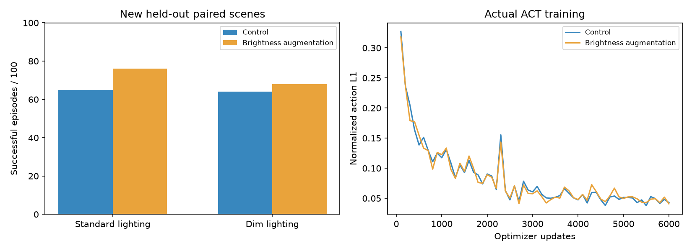

# 亮度增强：真实训练与新场景对照实验

我代你完成了本机代码、实际训练和评测。这个实验只改变训练图片亮度，不改变动作答案、验证图片或仿真评测画面。

## 先看结论

变暗光照下，亮度增强版相对对照版变化+4个百分点；普通光照变化+11个百分点。本次观察到光照场景的成功率提高。只有一个训练种子，结论限定于本次条件；不能据此声称普遍有效。

## 最终独立测试

| 版本 | 训练示范 | 更新预算 | 部署快照步数 | 普通光照 | 变暗光照 |
| --- | --- | --- | --- | --- | --- |
| Control | 100 | 6000 | 6000 | 65/100 | 64/100 |
| Brightness augmentation | 100 | 6000 | 6000 | 76/100 | 68/100 |

每组使用相同的新种子50000—50099，普通与变暗条件也配对。共400回合，不是400个互不相关的初始位置。旧61/100使用不同测试种子，不能直接与本表比较来认定改进。

## 同一个场景，哪些变好、哪些变坏

| 条件 | 两版都成功 | 原失败、新成功 | 原成功、新失败 | 两版都失败 |
| --- | --- | --- | --- | --- |
| standard | 56 | 20 | 9 | 15 |
| lighting | 49 | 19 | 15 | 17 |

这样可以看到模型具体在哪些场景获得收益、又在哪些场景退步。

## 开发集诊断

| 版本 | 普通光照 | 变暗光照 |
| --- | --- | --- |
| Control | 8/20 | 10/20 |
| Brightness augmentation | 14/20 | 12/20 |

开发种子21000—21019与最终测试、训练和验证均隔离。本轮预先固定增强范围，没有根据这些分数调整后再挑选结果。

## 到底改了什么

对同一训练样本的两张RGB图，乘同一个随机亮度因子0.4—1.4，限制到合法像素范围，再做ImageNet归一化。可以理解成给老师的照片调亮、调暗，老师的动作答案保持原样。

这只是光照变化的近似训练方法。真实评测在MuJoCo中改变灯光，物理渲染不等价于简单乘像素，因此必须实测。背景颜色和纹理没有在本轮改变，也没有证明背景泛化得到改善。

## 公平性和审计

- 数据相同：base的80条＋random的20条训练示范；独立20条验证。
- 两组从相同的ACT动作模型随机初始化重新训练，视觉骨干沿用ImageNet预训练。
- 初始参数SHA256相同；网络、归一化、seed42、batch8与6000次预算相同。
- 增强使用独立随机数，避免改变模型初始化与数据抽样随机数。
- 验证与推理不做亮度增强；训练与曲线均为真实记录。每次快照从20个验证回合固定等距抽取200帧动作块，按误差选择。
- 模型加载后自主执行，输入仅两路RGB和6维关节状态，不调用专家。
- 仍要求双侧夹爪真实接触抬起、到位、释放并稳定一秒。
- 原始数据、第一轮三个模型与旧成绩保留；文件指纹校验通过。

## 当前边界

单物体、固定目标与受限初始范围的仿真实验，尚未部署真实机械臂。没有保证80/100，也没有实现强化学习或完整DAgger。下一轮应先选一个开发问题，再设置新的独立考试。

演示来源：results/brightness_aug/brightness_test-lighting-dense/success.mp4，为亮度增强模型在变暗光照下的success回合。两组每种条件的成功与失败视频保存在对应brightness_test目录。
