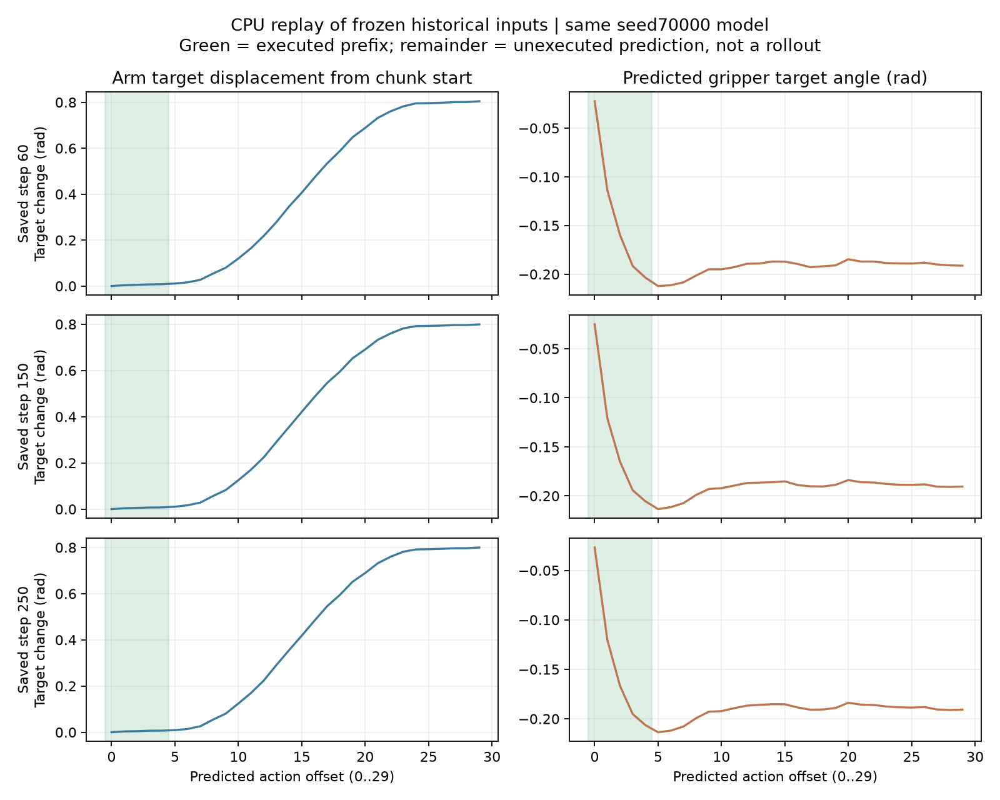

# 固定历史观测下的ACT动作块重放

只在CPU上加载原background_control权重，读取5步窗口失败回合seed70000的第60、150、250控制步已保存图像与本体状态，重新预测完整30步。没有运行环境、施加新动作、训练或计算新的成功率。

## 数值核对

表中关节变化是前五个关节目标向量相对offset0的L2范数，不是单个关节转角或实际末端位移。

| 保存的控制步 | 重放前5步与原实际指令的最大绝对差rad | 预测offset4相对offset0的前五关节目标变化rad | offset29相对offset0变化rad |
|---|---:|---:|---:|
| 60 | 6.00e-05 | 0.0080 | 0.8045 |
| 150 | 5.55e-05 | 0.0076 | 0.7993 |
| 250 | 2.35e-05 | 0.0069 | 0.7998 |

前5步与历史实际指令的差小于1e-3rad，核对了本次CPU重放与历史GPU执行前缀的数值一致性。尾部变化描述模型在同一张历史观测下继续预测了什么，并不表示执行尾部一定能抓起，也不是已验证的纠错方案。

绿色区域是历史5步窗口真正执行的前缀；后续预测当时被丢弃。该诊断可以提出“短窗口反复重启相似动作前段，未充分推进”的假设，但它只覆盖一个失败初始条件。验证机制及改进收益仍需独立开发和新测试，不能由这三次重放直接作因果结论。

完整预测、模型指纹与数值误差见saved-observation-chunks.json。图中动作是预测目标，不是实际机器人状态或物体轨迹。
