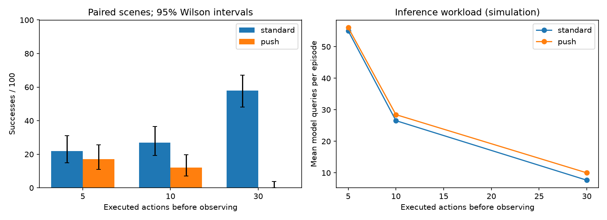
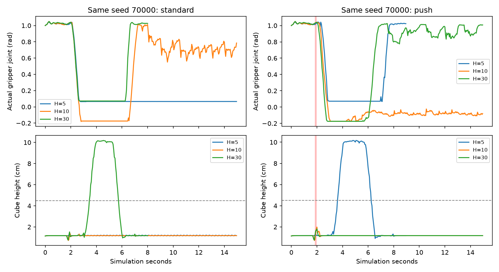

# ACT重新观察频率：真实实验报告

日期：2026-10-20。使用同一个已训练模型，不更新任何参数。一次预测30步，分别执行5、10、30步后重新看图。

## 最终100个新初始条件

| 执行步数 | 条件 | 成功 | 95%区间 | 平均查询次数 | 查询P50/P95毫秒 |
| --- | --- | --- | --- | --- | --- |
| 5 | 正常 | 22/100 | 15.0%—31.1% | 55.0 | 16.32/28.77 |
| 5 | 外力 | 17/100 | 10.9%—25.5% | 56.0 | 15.71/27.31 |
| 10 | 正常 | 27/100 | 19.3%—36.4% | 26.6 | 13.32/17.46 |
| 10 | 外力 | 12/100 | 7.0%—19.8% | 28.5 | 10.48/17.95 |
| 30 | 正常 | 58/100 | 48.2%—67.2% | 7.7 | 25.34/28.01 |
| 30 | 外力 | 0/100 | 0.0%—3.7% | 10.0 | 25.42/28.36 |

本轮正常任务中，30步窗口成功58/100，缩短到5步为22/100；外力条件下分别为0/100与17/100。同一模型的执行方式存在任务推进与扰动响应的取舍，更频繁地看图并未带来所有条件下的稳定提升。具体机制还需轨迹或新实验验证。

六组共600次执行，配对初始条件只有100组；另有120次开发检查。区间只描述固定模型在本测试初始条件分布下的抽样不确定性，不覆盖训练随机性。

平均查询次数同时受窗口长度和回合结束时间影响；成功较早的回合会提前停止。它衡量实际推理工作量，不能直接当作模型速度的提升倍数。

## 同题得失：以30步为对照

| 条件 | 新窗口 | 都成功 | 原失败新成功 | 原成功新失败 | 都失败 |
| --- | --- | --- | --- | --- | --- |
| standard | 5 | 13 | 9 | 45 | 33 |
| standard | 10 | 22 | 5 | 36 | 37 |
| push | 5 | 0 | 17 | 0 | 83 |
| push | 10 | 0 | 12 | 0 | 88 |

## 外力影响：同窗口正常→外力

| 窗口 | 两条件都成功 | 正常失败外力成功 | 正常成功外力失败 | 都失败 |
| --- | --- | --- | --- | --- |
| 5 | 7 | 10 | 15 | 68 |
| 10 | 4 | 8 | 23 | 65 |
| 30 | 0 | 0 | 58 | 42 |

这张表不等于失败恢复率。脉冲在固定时刻施加，没有限定当时正在抓取，也没有先判定失败再启动恢复控制器。外力偶尔可能把方块推到更容易的位置，应同时报告进步和退步。

## 失败分类

| 窗口 | 条件 | 未有效夹起 | 掉落或放偏 | 释放/稳定未达标 |
| --- | --- | --- | --- | --- |
| 5 | standard | 73 | 3 | 2 |
| 5 | push | 80 | 3 | 0 |
| 10 | standard | 58 | 15 | 0 |
| 10 | push | 82 | 6 | 0 |
| 30 | standard | 21 | 21 | 0 |
| 30 | push | 100 | 0 | 0 |

这些是规则统计的失败现象，不能仅靠标签断言感知错误或动作预测错误。代表回合保留动作、关节、方块位置、TCP和外力轨迹，应结合它们定位原因。

## 开发检查（不用于调参）

| 窗口 | 正常 | 外力 |
| --- | --- | --- |
| 5 | 3/20 | 6/20 |
| 10 | 9/20 | 3/20 |
| 30 | 14/20 | 0/20 |

## 方法与边界

模型固定为background_control：100条训练示范、20条独立回合验证、seed42训练6000次更新。ResNet18使用ImageNet预训练，ACT动作模块本地训练；本轮仅更改执行窗口，不训练新参数。

脉冲为世界y方向±0.12N、0.1秒，在第37—38控制步施加，方向由种子奇偶确定。MuJoCo计算实际位移，没有传送或绑定方块。所有窗口使用同一个模型、初始条件、成功判据和15秒仿真超时。

名义查询频率分别4、2、0.67Hz，均为仿真时间。延迟是同步CUDA查询的预处理到动作传回CPU耗时；仿真没有等待这段墙钟时间，不代表真实机器人实时闭环。窗口之间延迟差别也可能受GPU频率和运行顺序影响。

运行期间本机有其他WSL项目任务，延迟是该并发环境下的实测日志，不据此给不同窗口做算法速度排名。仿真任务按固定控制步推进，不按墙钟等待时间改变成功规则。

原始运行环境单独保存在original_environment.json：Python 3.12.3、Torch 2.7.1+cu126、NVIDIA GeForce RTX 4060 Laptop GPU。低层评测入口重跑会更新environment.json；它仅表示最近调用环境，不用于替换原始环境或为旧延迟提供新硬件背书。

短窗口反馈更及时，但也反复丢弃动作块后半段；是否导致阶段停滞应看轨迹，不能把所有下降都归因于它。没有使用最终测试来改变窗口、外力或模型。一个模型种子、单一方块、固定脉冲和受限位置分布不能证明普遍收益或实物迁移。

对旧结果的精确复现仍使用旧提交和协议；本轮没有改动旧核心源码。所有旧部署模型指纹检查通过。

上图来自预先选定的第一题seed70000，展示实际夹爪关节与方块高度。4.5cm虚线仅是有效抓起的高度要求，还需双侧接触；单条轨迹不能代替整体统计。脉冲时间窗标为红色。

## 看同一场景的实际执行

固定第一条正式场景seed70000，避免根据成败挑选展示。standard-comparison.mp4与push-comparison.mp4各横向对比三种窗口。画面来自实际查询时刻，查询间隔保持上一观测，已经标明不是逐帧录像；final标签是整回合最终结局，不表示画面当前时刻已成功或失败。每个条件另有首个成功／失败的原始帧和轨迹。

## 复现与证据

`./run_closed_loop.ps1 -Status`读取成绩；`./run_closed_loop.ps1`执行指纹匹配的评测缓存与报告。正式成绩位于test/{standard,push}-h{5,10,30}；development是另一分区。protocol.json锁定源码、XML、权重、种子和外力，verification.json记录完整审计。单元与整体验证见docs/closed-loop-progress.md。
